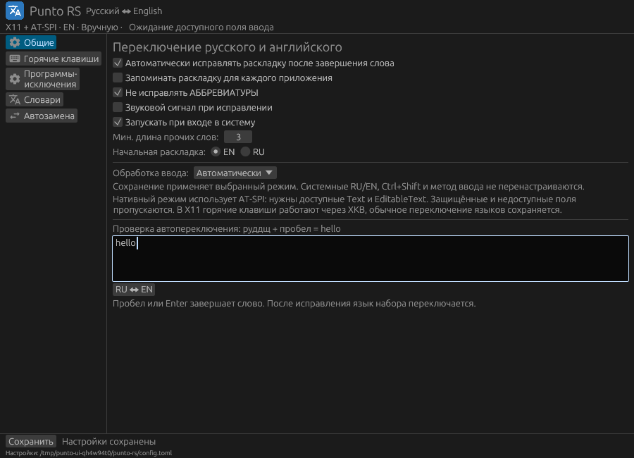

# Punto RS — переключатель раскладки для Ubuntu и MATE

[**Скачать .deb v0.2.4 (amd64)**](https://github.com/KroshkaRu/punto-rs/releases/download/v0.2.4/punto-rs_0.2.4_amd64.deb) · [Все релизы и контрольные суммы](https://github.com/KroshkaRu/punto-rs/releases)

Переключатель RU ↔ EN на Rust для Ubuntu 22.04–26.04. Общие словари Hunspell, правила, исключения, автозамены и настройки; несколько способов подключения к приложениям.

**Начиная с 0.2.0 по умолчанию используется нативный режим без IBus.** Программа не вызывает `im-config`, не запускает IBus/Fcitx, не заменяет список системных раскладок и сочетание Ctrl+Shift. При исправлении слова выбирается уже существующая RU/EN; для пользовательского сочетания регистрируется отдельная горячая клавиша.

## Исправлена совместимость новых Ubuntu; поддерживается MATE

**Ubuntu 22.04, 24.04 и 26.04, включая Ubuntu MATE / MATE в X11.** Нативный режим работает без обязательного IBus и сохраняет системное переключение RU/EN.

- **Исправление для новых Ubuntu / AT-SPI.** Разные версии `org.a11y.atspi.Registry.RegisterEvent` принимают разное число аргументов. Сигнатура теперь читается через D-Bus introspection: поддерживаются `s`, `sas`, `sass`. Регистрация событий больше не привязана к одной версии службы доступности. Нативный ввод проверяется отдельно на Ubuntu 22.04, 24.04 и 26.04.
- **Трей MATE/Ayatana.** Вместо одной только `IconPixmap` публикуются именованные Material PNG и `IconThemePath`; хост панели может найти настоящую иконку приложения и текущий язык. Нужен включённый в панели хост StatusNotifierItem / индикаторов. Графические настройки, автозапуск и меню трея входят в приложение.
- **Исправление слова меняет язык дальнейшего ввода.** Например, `руддщ ` → `hello ` с выбором EN; `ghbdtn ` → `привет ` с выбором RU. Работают короткие словарные слова (`цу ` → `we `, `lf ` → `да `) и местоимение `I` (`Ш ` / `ш ` → `I `).
- **Пунктуация учитывает физические клавиши.** В `ghjdthz.` точка соответствует «ю»: результат `проверяю`. В `ghbdtn.` она остаётся точкой: `привет.`. Неоднозначные знаки ожидают пробела или Enter.

Поддержка AT-SPI всё ещё зависит от приложения. Матрица Ubuntu проверяет настоящий GTK3-ввод в Xvfb; проверка именованной иконки выполняется через GTK. Это не обещание работы любого поля в любом рабочем столе. Живой Wayland и полная матрица GNOME/Plasma/MATE вручную не проверены; условия и ограничения приведены ниже.



## Установка и запуск

Скачайте `.deb` из [релиза](https://github.com/KroshkaRu/punto-rs/releases/latest). В каталоге со скачанным файлом выполните:

```bash
install -m 644 ./punto-rs_0.2.4_amd64.deb /tmp/punto-rs_0.2.4_amd64.deb
sudo apt install /tmp/punto-rs_0.2.4_amd64.deb
punto-rs
```

В релизе есть `SHA256SUMS`; скачанный пакет можно проверить командой `sha256sum -c SHA256SUMS`. Если собирали самостоятельно, пакет находится в `dist/`.

Если APT пишет `Download is performed unsandboxed as root`, пакет недоступен пользователю `_apt` внутри домашнего каталога. Установка при этом не отменяется. Чтобы убрать уведомление, скопируйте `.deb` в `/tmp` с правами `644` и передайте APT путь `/tmp/punto-rs_0.2.4_amd64.deb`; открывать доступ ко всему домашнему каталогу не нужно.

Откроются настройки и трей. Закрытие настроек оставляет фоновый процесс; завершение — «Выход» в трее. Для запуска при входе: **Общие → Запускать при входе в систему → Сохранить**. Создаётся `$XDG_CONFIG_HOME/autostart/punto-rs.desktop`, обычно `~/.config/autostart/punto-rs.desktop`; запускается только фоновой процесс.

При обновлении закройте старую версию через трей, затем запустите установленную. Уже открытое окно настроек использует старый исполняемый файл.

### Компиляция и сборка `.deb`

Для переносимого пакета установите Docker и `dpkg-dev`, затем выполните из корня репозитория:

```bash
./scripts/build-deb.sh
```

Скрипт сам создаёт контейнер Ubuntu 22.04 с Rust 1.88.0, компилирует код с `Cargo.lock` и вызывает упаковщик. Результат — `dist/punto-rs_0.2.4_amd64.deb` на x86_64. Сборка на glibc 2.35 обеспечивает базу для Ubuntu 22.04–26.04. Нужны доступ к Docker и сеть для загрузки образа и зависимостей; контейнер использует сеть хоста. Исходники монтируются только для чтения; артефакты и кеши остаются в `target/` и принадлежат запустившему пользователю. Скрипт не устанавливает пакет и не запрашивает sudo.

Для сборки установленным Rust 1.88+ на текущей машине:

```bash
sudo apt install build-essential pkg-config dpkg-dev
./scripts/build-deb.sh --native
```

Этот вариант требует Rust в PATH и компилирует под текущую систему; сборка на новой Ubuntu не гарантирует запуск на старой. Для публичного пакета используйте вариант с контейнером Ubuntu 22.04.

Отдельная установка из исходников для текущего пользователя:

```bash
sudo apt install build-essential pkg-config at-spi2-core hunspell-ru hunspell-en-us
./scripts/install.sh
```

Установщик работает для текущего пользователя, без sudo; файлы помещаются в `~/.local/bin` и `$XDG_DATA_HOME`/`~/.local/share`. Для автозапуска `~/.local/bin` должен быть в PATH графического сеанса. Удаление из исходников: `./scripts/install.sh --uninstall`; из пакета: `sudo apt remove punto-rs`. Настройки сохраняются.

## Способы подключения

В **Общие → Обработка ввода** доступны «Автоматически», «Нативный» и «IBus». Сохранение переключает бэкенд без перезапуска; два бэкенда одновременно не обрабатывают текст. «Автоматически» выбирает нативный режим для текущего сеанса, не переводит систему на IBus.

| Вариант | Что реализовано | Условия |
|---|---|---|
| X11 + AT-SPI | Автокоррекция, выделение, проверяемый откат, глобальные сочетания через XGrabKey, смена существующей XKB-группы | Поле предоставляет Text и EditableText; RU/EN настроены в системе |
| Wayland + AT-SPI | Тот же доступ к тексту и выделению без IBus | Доступность предоставляется приложением; сочетания и источник языка подключаются отдельно |
| GlobalShortcuts portal | Регистрация сочетаний и обработка Activated; отмена разрешения не отключает текстовый бэкенд | Рабочий стол предоставляет портал; пользователь нажимает кнопку подключения |
| Fcitx5, уже настроенный | Чтение текущего движка и смена существующих keyboard-us/keyboard-ru в текущей группе на Wayland; текст — через AT-SPI | Fcitx5 запущен пользователем. Группы и конфигурация Fcitx не меняются; отдельного движка Punto для Fcitx нет |
| Plasma Wayland | Чтение существующих раскладок и setLayout через org.kde.KeyboardLayouts | Служба org.kde.keyboard уже доступна |
| GNOME Wayland | Опциональное расширение сообщает активное окно, блокировку и переключает существующие XKB-источники | Мост устанавливается и включается пользователем |
| IBus | Отдельный добровольный движок с preedit, surrounding text, выделением и откатом | IBus уже настроен; выбран режим IBus и источник Punto RS |

Диагностика не меняет систему:

```bash
punto-rs --backends
punto-rs --check
```

### Нативный режим

Текст уже набирается обычным способом. Когда приложение сообщает вставку разделителя (например пробела), бэкенд проверяет завершённое слово: `руддщ ` → `hello `, `ghbdtn ` → `привет `. Переключение группы XKB не заменяет системный keymap и его опции.

AT-SPI позволяет проверить роль поля, доступность редактирования, текст, курсор и выделение до изменения. Пароли и недоступные поля пропускаются. Чтение ограничено 262144 символами и 1 МиБ UTF-8. Изменения проверяются повторно; откат допускается только при совпадении ожидаемых текста, позиции и поля. Буфер обмена не используется и не перезаписывается. Если вставка отклонена, исходный фрагмент не удаляется; при отказе приложения на промежуточном шаге возможен дублированный фрагмент с сообщением об ошибке.

**Это не универсальная поддержка любых полей.** Приложение должно публиковать Text и EditableText через AT-SPI. Поддержка различается у GTK, Qt, Chromium/Electron, Snap и Flatpak. Некоторые приложения требуют включённой системной доступности либо запуска с поддержкой accessibility; Punto не включает её скрытно. Готовность шины не означает готовности конкретного поля — состояние видно в настройках и трее. Терминалы и менеджеры паролей исключены по умолчанию. Достоверность признака защищённого поля зависит от приложения. Форматирование заменённого фрагмента может измениться. Преобразование рассчитано на стандартные QWERTY/ЙЦУКЕН; альтернативные фонетические раскладки отдельно не проверены.

Горячие клавиши X11 регистрируются с учётом CapsLock/NumLock. Занятые другим приложением сочетания не отбираются; сообщение содержит список конфликтов. Ctrl+Shift не регистрируется Punto и остаётся системным. В Wayland: сохраните сочетания, затем **Горячие клавиши → Разрешить глобальные сочетания**. Рабочий стол покажет диалог; после изменения привязок подключите их снова. Наличие xdg-desktop-portal не гарантирует наличие интерфейса GlobalShortcuts.

При отсутствии адаптера раскладки Wayland текст ещё может преобразовываться через AT-SPI, но смена системного источника не выполняется и показывается сообщение. XWayland не используется как замена перехвату нативных Wayland-приложений.

### Добровольный IBus

Punto больше не устанавливает IBus обязательной зависимостью. Если вы уже используете IBus, выберите **Общие → Обработка ввода → IBus → Сохранить**. Кнопка **«Выбрать Punto RS в IBus»** только выбирает движок в уже запущенной службе. Она не запускает службу, не пишет `.xinputrc` и не меняет переменные окружения.

Один источник Punto RS обслуживает оба языка. Слово отображается как стандартный preedit и фиксируется при разделителе; ручные команды действуют в поле ввода. Преобразование выделения и проверяемый откат требуют surrounding text и корректного anchor от клиента. Не поддерживающее их поле получает сообщение, а текст не удаляется вслепую. Поля Password/PIN/PRIVATE обходятся; в них используется базовая системная US-раскладка движка.

Команда `punto-rs --ibus` служит точкой запуска движка IBus; обычный запуск и `--daemon` используют выбранный в настройках бэкенд. Если уже работает другой бэкенд, сначала переключите режим в настройках.

### Опциональный мост GNOME

```bash
./scripts/install.sh --extension
# Для установки из deb:
/usr/share/punto-rs/scripts/install.sh --extension
# После выхода и входа в сеанс:
gnome-extensions enable punto-focus@punto-rs.local
```

Выбирается формат расширения для GNOME 42–44 или 45–51. Мост сообщает активное приложение/заголовок/блокировку и выбирает **только уже настроенные** XKB-источники us/ru, сохраняя их варианты. На экране блокировки запросы отклоняются. Расширение не устанавливается и не включается автоматически. Для трея GNOME нужен AppIndicator; в MATE/Xfce/Plasma — хост StatusNotifierItem.

## Функции и настройки

| Действие | По умолчанию |
|---|---|
| Автоматика вкл./выкл. | Ctrl+Alt+A |
| RU ↔ EN | Ctrl+Alt+Space |
| Исправить выделение | Ctrl+Alt+S |
| Исправить слово | Pause |
| Отменить преобразование | ScrollLock |
| Изменить регистр выделения | Ctrl+Alt+U |
| Транслитерация | Ctrl+Alt+T |
| Пауза для приложения | Ctrl+Alt+P |

Словари — `/usr/share/hunspell/en_US.{aff,dic}` и `/usr/share/hunspell/ru_RU.{aff,dic}`, с учётом словоформ. Исправление происходит, если слово неизвестно в исходном языке и известно после преобразования. Неоднозначные и неизвестные слова остаются; исключаются адреса, числа и аббревиатуры. Слова из 1–2 букв проверяются по тем же словарям независимо от порога длины: `цу ` → `we `, `lf ` → `да `. Английское местоимение `I` распознаётся отдельно от аббревиатур: `Ш ` / `ш ` → `I ` с переключением в EN; пользовательские исключения и правила сохраняют приоритет. Если исходный вариант также словарный (например `vs` / `мы`), автоматической замены нет; принудительное правило позволяет выбрать нужный вариант. Есть пользовательские слова, исключения, принудительные правила `исходное = исправленное`, автозамены `сокращение = полный текст` с `\n` для новой строки. Доступны запоминание раскладки для приложения, принудительная раскладка, исключения по приложению и заголовку, необязательный звук.

В «Общие» поле проверки исправляет завершённое пробелом, Enter или знаком `!?` слово теми же словарями и правилами: `руддщ ` → `hello `, `ghbdtn ` → `привет `. Галочка автоматики действует сразу; изменения словарей и автозамен применяются после сохранения. Проверка изменяет только текст этого поля; после смены языка слова через фоновый процесс выбирается соответствующая существующая раскладка для дальнейшего ввода, как при исправлении в других приложениях. Ошибка переключения показывается внизу окна; текст остаётся исправленным. Состав RU/EN и системные сочетания не меняются. Точки, запятые, `;`, `:`, кавычки и скобки могут соответствовать буквам другой раскладки: `ghjdthz. ` → `проверяю `, `k.,k. ` → `люблю `. Сначала проверяется слово целиком, затем варианты с сохранением окружающей пунктуации; неоднозначные знаки ожидают завершения слова пробелом. Адреса с `@`, URL, числа и неизвестные обоим словарям токены пропускаются. Если запись похожа на домен и одновременно даёт словарное слово после преобразования, возможна ложная коррекция: для таких записей используйте «Не исправлять». Токены длиннее 128 знаков пропускаются. Кнопка RU ↔ EN оставлена для ручного преобразования.

Настройки: `$XDG_CONFIG_HOME/punto-rs/config.toml`, обычно `~/.config/punto-rs/config.toml`. Старые файлы без `backend` читаются; значение по умолчанию — `auto`. Сохранение атомарное. Повреждённый файл не заменяется настройками по умолчанию при запуске движка.

```bash
punto-rs --default-config
punto-rs --convert 'Ghbdtn vbh!'
punto-rs --settings
```

Иконки взяты из Material Design Icons (`translate`, `keyboard`, `settings`, `undo`, `swap_horiz`, Round), Apache 2.0. Исходные SVG/лицензия — `assets/material-icons/`, растеризация — `scripts/render-icons.py`. В трее — `translate` с RU/EN; MATE получает именованные PNG и каталог темы, другие хосты также IconPixmap. Дневника набора, истории буфера и сетевой отправки текста нет; текст остаётся только в памяти для текущей операции/проверяемого отката.

## Исследованные альтернативы

Основные источники и причины выбора:

- [AT-SPI Text](https://gnome.pages.gitlab.gnome.org/at-spi2-core/devel-docs/doc-org.a11y.atspi.Text.html), [EditableText](https://gnome.pages.gitlab.gnome.org/at-spi2-core/devel-docs/doc-org.a11y.atspi.EditableText.html), [события](https://gnome.pages.gitlab.gnome.org/at-spi2-core/devel-docs/doc-org.a11y.atspi.Event.Object.html): реализованы текстовый бэкенд и проверка границ/ролей.
- [XKB](https://www.x.org/releases/current/doc/kbproto/xkbproto.html): используется смена существующей группы. [XRecord](https://www.x.org/releases/X11R7.6/doc/recordproto/record.html) и XTest подходят для наблюдения/синтеза X11-событий, но сами не дают роли защищённого поля, выделения и проверяемого surrounding text. Такой общий перехватчик пока не реализован; нативный режим редактирует через AT-SPI.
- [GlobalShortcuts](https://flatpak.github.io/xdg-desktop-portal/docs/doc-org.freedesktop.portal.GlobalShortcuts.html): реализованы сессия, пользовательское разрешение, привязки и Activated.
- [Fcitx5 Controller](https://github.com/fcitx/fcitx5/blob/master/src/modules/dbus/dbusmodule.cpp) и [KWin keyboard_layout](https://github.com/KDE/kwin/blob/master/src/keyboard_layout.cpp): реализованы адаптеры существующих раскладок. [Полноценный Fcitx addon](https://fcitx-im.org/wiki/Develop_an_simple_input_method) — отдельная интеграция с самим фреймворком, сейчас не реализована.
- [Wayland input-method-v2](https://wayland.app/protocols/input-method-unstable-v2): полноценный протокол метода ввода, доступность зависит от композитора и выбранного IM. Отдельный движок не реализован.
- [RemoteDesktop/libei](https://flatpak.github.io/xdg-desktop-portal/docs/doc-org.freedesktop.portal.RemoteDesktop.html) позволяет эмуляцию ввода с разрешением, но не предоставляет редактируемое поле и его текст. [InputCapture](https://flatpak.github.io/xdg-desktop-portal/docs/doc-org.freedesktop.portal.InputCapture.html) предназначен для активного захвата устройств; это не прозрачный наблюдатель слов. Эти пути не используются как скрытая замена пользовательскому вводу.

## Проверки

```bash
cargo fmt --check
cargo clippy --all-targets --locked -- -D warnings
cargo test --all-targets --locked
cargo build --locked
xvfb-run -a dbus-run-session -- python3 tests/native_integration.py target/debug/punto-rs
PUNTO_TEST_GTK=1 xvfb-run -a dbus-run-session -- python3 tests/ibus_integration.py target/debug/punto-rs
xvfb-run -a dbus-run-session -- python3 tests/ui_smoke.py target/debug/punto-rs /tmp/settings.png
```

Тесты запускаются в отдельных X11/D-Bus и временном HOME, не на рабочем столе пользователя. Нативный тест использует настоящие физические XTest-события в Xvfb и настоящий GtkTextView: оба направления автокоррекции, Ctrl+Shift, выделение, откат и его отказ после перемещения курсора, пароль, сохранение keymap/опций, `.xinputrc`, буфера обмена и отсутствие запуска IBus.

`PUNTO_TEST_DRIVER=gnome|kde|fcitx` запускает тот же текстовый тест через протоколы адаптеров и фиктивный GlobalShortcuts portal, включая отмену разрешения. Здесь имитируются службы композитора/контроллера; это **не проверка живого Wayland-сеанса или настоящего Fcitx5**. Проверка реальных GTK3-полей не гарантирует поддержку Chromium/Electron/Qt и всех Snap/Flatpak. Живые GNOME/Plasma/расширение требуют отдельной проверки.

CI содержит Ubuntu 22.04, 24.04, 26.04. Задание Ubuntu 22.04 также вызывает `scripts/build-deb.sh --native` и сохраняет пакет с контрольной суммой как артефакт запуска. Готовые публичные установщики находятся в [Releases](https://github.com/KroshkaRu/punto-rs/releases). Переносимый deb собирается на Ubuntu 22.04:

```bash
./scripts/package-deb.sh target/ubuntu22/release/punto-rs
```

Скрипт только собирает пакет, не устанавливает его в текущую систему.

## Устройство исходников

В модулях оставлены комментарии о границах платформ и причинах нестандартных решений:

| Файлы | Ответственность |
|---|---|
| `dictionary.rs`, `layout.rs` | Общие словари, короткие слова, пунктуация и соответствие клавиш RU/EN |
| `native.rs`, `x11.rs` | AT-SPI, проверяемая замена и откат, выбор существующей XKB-группы, горячие клавиши X11 |
| `engine.rs`, `service.rs` | Машина ввода IBus и API управления D-Bus |
| `session_layout.rs`, `portal.rs`, `desktop.rs` | Адаптеры рабочего стола, разрешение сочетаний Wayland и контекст приложения |
| `ui.rs`, `tray.rs`, `icons.rs`, `autostart.rs` | Настройки, поле проверки, трей MATE/Ayatana, Material-иконки и автозапуск |
| `config.rs`, `hotkey.rs`, `setup.rs`, `main.rs` | Конфигурация, сочетания, добровольная настройка IBus и запуск |
| `scripts/build-deb.sh`, `scripts/package-deb.sh` | Компиляция и упаковка `.deb` без установки |
| `tests/` | Модульные проверки и интеграционные сценарии в отдельных X11/D-Bus-сеансах |

## Лицензия

Исходники — [MIT](LICENSE). Material Design Icons — Apache 2.0; лицензия и атрибуция находятся в `assets/material-icons/LICENSE` и `assets/material-icons/NOTICE`. Проект независим от оригинального Punto Switcher и не является его официальной версией.
